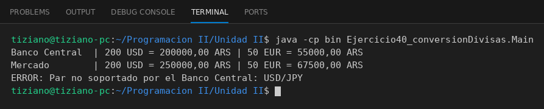

# ProveedorTasaCambio

Programación II - Unidad 2 - Ejercicio 40

## Consigna
Convertir montos entre monedas con distintas fuentes de tasas de cambio.

## Lógica
- Clase abstracta `ProveedorTasaCambio` con `double obtenerTasa(origen, destino)`.
- `TasaBancoCentral` y `TasaMercadoLibre` devuelven cotizaciones simuladas y rechazan pares no soportados.
- `ConversorMoneda` recibe un proveedor y calcula `monto * tasa`.
- `Main`: la misma conversión con las dos fuentes y un par inválido.

## Ejecución

